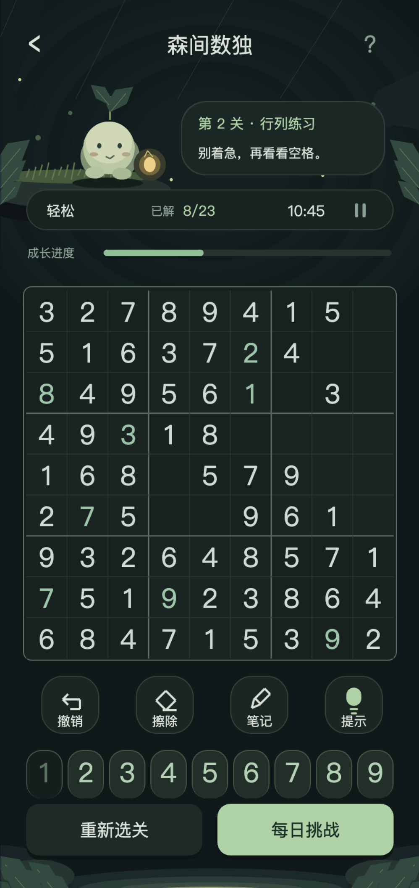

<div align="center">

# 森间数独 · Shujian

在森林里，解开下一格。

一个使用 **TypeScript + Cocos Creator** 开发的开源数独原型，带实操教学、程序生成关卡，以及可直接运行的浏览器试玩。


[快速开始](#快速开始) · [玩法与功能](#玩法与功能) · [Cocos 工程](#cocos-工程) · [开发计划](#开发计划)



*当前浏览器版本的实际截图，场景和角色由矢量图形绘制。*

</div>

## 关于项目

森间数独尝试把经典数独放进一个安静的森林场景。小芽灵陪玩家完成教学，深色棋盘用不同亮度区分选中格、关联格和相同数字，薄荷绿表示玩家输入，红色表示直接冲突。

游戏规则、画面描述和交互区域集中在共用 TypeScript 模块中。浏览器 Canvas 和 Cocos Graphics 分别实现绘制接口，方便先在浏览器迭代，再验证引擎端表现。运行时不依赖在线图片、远程字体或游戏服务器。

> **项目状态：早期可玩原型。** 浏览器版本已通过自动化测试、类型检查及构建。Cocos 工程提供场景与适配代码，尚未完成 Creator 内导入验证或抖音真机测试。目前没有抖音发布包、账号登录、广告和联机服务。

## 玩法与功能

### 经典规则

在 9×9 棋盘中填入数字 1～9，使每一行、每一列和每个 3×3 宫内的数字都不重复。题面数字不可修改，生成的题目要求唯一解。

### 从第一关开始

第一关只保留三个空格，依次介绍行、列和九宫格约束。目标格有边框提示，选中后对应数字键亮起。完成教学后进入第二关，解锁进度随存档保存。

当前教学采用受限输入引导；逐步减少提示、允许试错并解释原因的教学仍在计划中。

### 当前可以体验

- **程序生成关卡**：按关号确定种子，支持持续生成后续关卡。
- **逻辑筛选**：关卡生成过程中用单格唯一候选和单元唯一位置两类技巧检查可解性。
- **自由练习**：轻松、适中、挑战三种生成参数；当前界面提供适中练习入口。
- **每日挑战**：按设备本地日期生成题目，无需服务器。
- **笔记与撤销**：记录候选数，撤销同时恢复受影响的笔记。
- **逻辑提示**：标出可推理的位置和技巧，确认后填入数字。
- **暂停与存档**：暂停时隐藏棋盘，离开页面自动暂停，进度保存在本地。
- **森林主题**：芽灵、灯笼、苔石、萤火与溪流均由共用绘制层生成。

## 快速开始

建议使用 Node.js 22 或 24 LTS 与 npm。

```bash
git clone git@github.com:tetap/open-source-sudoku.git
cd open-source-sudoku
npm ci
npm run preview
```

打开终端输出的本地地址，默认是 `http://127.0.0.1:5173`。指定端口可以执行：

```bash
npm run preview -- --port 5178
```

**操作方式**

- 触屏或鼠标：选中空格，再点击数字键。
- 键盘：`1`～`9` 填数，`Backspace` / `Delete` 擦除，`N` 切换笔记。
- 浏览器存档只保存在当前设备，不会上传。清除站点数据会删除进度。

### 检查与构建

```bash
npm test
npm run check
npm run build:preview
```

浏览器构建产物位于 `dist/`。可将该目录部署到普通静态网站托管服务。它是 Web 试玩产物，不能直接作为抖音小游戏上传。

## Cocos 工程

工程元数据指定 **Cocos Creator 3.8.6**。

1. 在 Cocos Dashboard 中导入本仓库根目录。
2. 等待资源导入，打开 `assets/Main.scene`。
3. 检查脚本编译、字体、相机和触摸坐标，然后运行场景预览。
4. 若自动生成的场景未能正确导入，可以在空场景中创建节点，挂载 `Shujian` 组件。组件会创建相机、Canvas 和游戏界面。

### 抖音小游戏目标

在 Creator 内验证通过后，可选择「项目 → 构建发布 → 抖音小游戏」，填入你自己的 AppID，并使用抖音开发者工具加载构建目录进行真机测试。

当前尚未验证屏幕安全区域、平台生命周期、包体限制和存储兼容性，也未接入分享、广告或平台账号。正式上线还需要完成平台要求的资质与审核。

参考 [Cocos 官方抖音小游戏发布说明](https://docs.cocos.com/creator/3.8/manual/zh/editor/publish/publish-bytedance-mini-game.html)。

## 代码导览

```text
assets/
  Main.scene               Cocos 场景入口
  scripts/
    Sudoku.ts              盘面生成、逻辑求解、状态与存档
    GameView.ts            界面布局、点击区域、教学与提示
    Forest.ts              共用森林矢量美术
    Shujian.ts             Cocos 绘制与生命周期适配
preview/
  main.ts                  浏览器 Canvas 适配与输入
 tests/                    数独规则、教学与闯关测试
 docs/images/              README 实际截图
```

`Painter` 接口连接界面描述与具体渲染器。修改玩法和布局时从 `Sudoku.ts`、`GameView.ts` 入手；修改场景从 `Forest.ts` 入手；涉及平台输入和字体时分别检查两个渲染适配器。

## 生成算法与当前边界

自由练习通过行、列、数字重排生成完整盘面，逐格挖空，并使用回溯求解器验证唯一解。闯关模式额外使用逻辑求解器筛选挖空结果，前期限制为单格唯一候选，后期允许单元唯一位置。

当前算法具有明确边界：

- 完整盘面的结构来自基础盘面变换，长期游玩的结构多样性仍需提升。
- 后期关卡允许出现某类技巧，不保证每道题都必须用到该技巧。
- 仅支持两类基础技巧；没有高级技巧评级或玩家能力自适应。
- 关号可持续生成题目，但不保证题目永不重复，也不意味着难度无限增长。
- 进度目前按正确填入的空格计算，可能间接暴露答案；需要改为已填进度并单独提供答案检查。
- 撤销记录只保存在本次会话中，重新进入后不恢复。
- 尚未实现 6×6、Killer 数独、多人模式和完整无障碍操作。

## 开发计划

- [ ] 完善可试错的新手教学，增加笔记与撤销教学关。
- [ ] 分离直接冲突、答案检查与进度展示。
- [ ] 增加候选数消除技巧与可解释难度评级。
- [ ] 增加盘面结构多样性与近期题目去重。
- [ ] 保存撤销历史，完善每日挑战记录。
- [ ] 完成 Creator 导入、屏幕适配与抖音真机验证。
- [ ] 改进角色反馈、图形细节与键盘可访问性。

## 参与贡献

欢迎提交 [Issue](https://github.com/tetap/open-source-sudoku/issues) 或 [Pull Request](https://github.com/tetap/open-source-sudoku/pulls)。报告问题时，请附上复现步骤、浏览器或引擎版本，以及截图；不需要提供个人存档或平台凭据。

涉及玩法的改动请补充可验证的测试，并在提交前运行 `npm test`、`npm run check` 和 `npm run build:preview`。

## 许可证与说明

本仓库代码及随附原创矢量美术以 [MIT License](LICENSE) 开源。第三方依赖遵循各自许可证，系统字体未随仓库分发。

本项目参考经典数独玩法进行独立实现，与其他同类 App 无隶属关系。仓库不包含第三方 App 源码、设计参考图或其商业美术素材。
